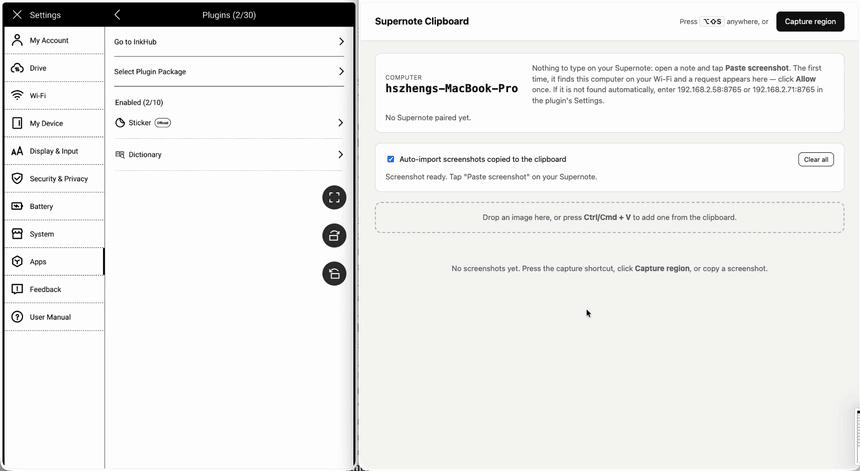
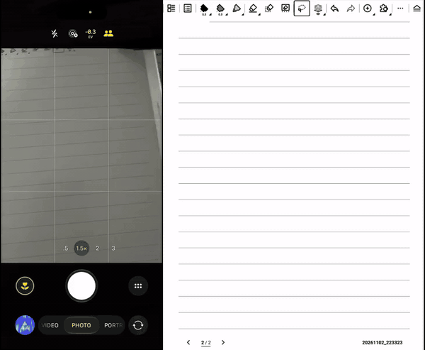

# PC Clipboard for Supernote

Copy something on your computer, then tap Paste from PC on the Supernote. A screenshot or a copied image goes in as a picture. Copied text goes in as a text box.

You can also send a photo or copied text from your phone. Tap Paste from phone, scan the QR code, and pick a photo or paste what you copied. The phone needs no app. Details are in [Paste from your phone](#paste-from-your-phone).



[Watch the Full PC video](docs/pc_demo.mp4).



[Watch the Full phone video](docs/phone_demo.mp4).


The project has two parts:

| Part | Where it runs | What it does |
| --- | --- | --- |
| `desktop/sn_clipboard.py` (Supernote Clipboard) | Your computer (macOS, Windows, Linux) | Holds images, screenshots, and text until the Supernote asks for them |
| `supernote-plugin/` (PC Clipboard) | Supernote, inside a note | Toolbar buttons that pull an image or text from the computer, or take one from your phone, and put it on the page |

Both have to be on the same Wi-Fi.

## Download

The latest files are on the [Releases](../../releases) page.

| File | For |
| --- | --- |
| `PCClipboard.snplg` | The plugin ([step 2](#2-install-the-plugin-on-your-supernote)) |
| `SupernoteClipboard-macOS-<version>.zip` | The macOS menu bar app. Apple Silicon and Intel, macOS 13 or newer. |
| `SupernoteClipboard-Windows-<version>.zip` | The Windows app. Unzip it and run `SupernoteClipboard.exe`. |

Installing the Mac app:

1. Unzip it and drag Supernote Clipboard.app into Applications.
2. Open it. Apple has not notarized the app, so the first launch is blocked ("Apple could not verify..."). In System Settings → Privacy & Security, scroll down, click Open Anyway, and open the app again.
3. It runs on Python 3, which is not inside the app. macOS may ask you to install the command line developer tools.
4. The first capture asks for Screen Recording. Turn on Supernote Clipboard under System Settings → Privacy & Security → Screen Recording, then quit the app and open it again.

Linux has no packaged app. Run `desktop/sn_clipboard.py` from the source, below.

## 1. Start Supernote Clipboard on your computer

You need Python 3.8 or newer. Nothing else from pip.

### macOS menu bar app

Use the zip from Releases, or build it:

```bash
desktop/macos/build-app.sh --install
```

That needs the Xcode command line tools (`swiftc`). It builds Supernote Clipboard.app and puts it in /Applications. The camera icon in the menu bar has Capture Region, Open Window, Open at Login, Show Log, and Quit. The first capture asks for Screen Recording. Allow it, then quit and reopen.

The app is a short Swift program (`desktop/macos/SupernoteClipboard.swift`) that runs a copy of `sn_clipboard.py`. After you change either file, run `build-app.sh --install` again. The build signs the app with a certificate kept in `~/Library/Application Support/Supernote Clipboard/`, created the first time you build, so the Screen Recording permission survives a rebuild. If macOS keeps asking even though Supernote Clipboard is already enabled, remove it from the Screen Recording list, or run `tccutil reset ScreenCapture com.rnic.supernote-clipboard`, and allow it again. Don't run the menu bar app and the terminal copy at the same time. Both want port 8765.

### Windows app

Unzip `SupernoteClipboard-Windows-<version>.zip` and double-click `SupernoteClipboard.exe`. A window stays open while it runs. Close that window to quit. The browser opens at `http://localhost:8765`.

The first time a Supernote connects, Windows Firewall asks whether to allow Supernote Clipboard. Choose Allow on private networks. Windows will prevent an unrecognized app from starting. Choose More info, then Run anyway.

### From a terminal

```bash
python3 desktop/sn_clipboard.py
```

On a Mac you can also double-click `desktop/Supernote Clipboard.command`.

A browser window opens at `http://localhost:8765`. The Mac app only opens that window until a Supernote is paired. Leave the app running while you take notes.

Ways to get something into the app:

- Press `Option + Shift + S` on a Mac, or `Ctrl + Alt + S` on Windows, and drag over the area. It waits for the Supernote. `Esc` cancels. Capture region in the window does the same thing.
- If your usual tool already copies the screenshot (Xnip, CleanShot, Snagit), the app picks it up. On a Mac that shortcut is `Cmd + Ctrl + Shift + 4`. The Ctrl is what copies it. On Windows, `Win + Shift + S`. On Linux you need a tool that copies a PNG, plus `wl-clipboard` or `xclip`.
- Copy one or more image files in Finder or Explorer. Each becomes an item.
- Text you copy is picked up too, and pasted on the Supernote as a text box.
- Drag images onto the window, or press `Cmd/Ctrl + V` in it. That works for images and text.

The newest item is marked Next paste. Use next on an older one makes that the one that gets pasted.

The shortcut can be changed. Start once with `--hotkey`, for example `--hotkey cmd+shift+2`. Modifiers are `cmd` or `win`, `ctrl`, `alt` or `option`, `shift`, plus a letter or digit. `--hotkey off` turns it off. The app remembers the choice. Pick keys nothing else is using. On Linux, bind `python3 /path/to/desktop/sn_clipboard.py capture` to a shortcut in the desktop settings instead.

Other commands: `sn_clipboard.py add image.png`, `sn_clipboard.py --port 9000`, `--no-watch` (don't import images from the clipboard), `--no-browser`.

### What is stored, and for how long

Everything stays in `~/.sn-clipboard/`. Images and text are in `shots/`. Paired Supernotes are in `config.json`. Nothing is uploaded. Only a Supernote you have allowed can download items, and only on your local network.

Storage in the window has three limits. Each one can be No limit, or a value you type under Custom... Time limit accepts a time such as `60s`, `2m`, `1h`, or `7d`. The menu bar shows the current choice.

| Limit | Default | Command line |
| --- | --- | --- |
| Time limit. Older items are removed. | 7 days | `--keep-days N` |
| Keep at most. Only the newest items stay. | 30 items | `--max-items N` |
| Use at most. The oldest items go when the folder grows past this. | No limit | `--max-mb N` |

On the command line, `0` means no limit. Shorter than a day is set in the window. The window shows how much space the items are using. A size limit will not delete the newest item, so one large screenshot can still be pasted. Delete removes one item. Clear all removes every item.

Turn on "Delete an item after the Supernote pastes it" and that item is removed as soon as the paste succeeds. The time limit still removes anything that was not pasted. Either one is enough.

A picture is saved in `SCREENSHOT/PC Clipboard/` on the Supernote before it is placed in the note, and that copy stays there. The picture in the note is separate. Photos sent from a phone are saved in the same folder. Pasted text is only in the note.

## 2. Install the plugin on your Supernote

Your Supernote needs firmware with plugin support (Settings → Apps → Plugins).

1. Download `PCClipboard.snplg` from [Releases](../../releases), or build it as below. Connect the Supernote over USB, or use Browse & Access, and copy the file into MyStyle.
2. On the Supernote: Settings → Apps → Plugins → Add Plugin, choose `PCClipboard.snplg`, and install.
3. Open a note. The toolbar has three buttons. Paste from PC puts in the newest screenshot or text. PC Clipboard lists recent screenshots and text so you can pick one, and Settings is in there too. Paste from phone shows a QR code so the phone can send a photo or copied text.

### The first paste

Tap Paste from PC. The plugin looks on the Wi-Fi for the computer running Supernote Clipboard. The computer asks "Supernote Manta wants to connect". On a Mac you also get a notification. Click Allow once. That paste goes through, and later pastes do too.

If the computer's IP changes, after a restart or on another network, the plugin finds it again. The pairing stays. Remove in the computer window forgets that Supernote.

The Supernote asks for permission the first time. Choose Always allow, or it will ask again next session. It needs Network, so it can download from the computer and receive photos from the phone. It needs file write and read, because downloaded pictures are saved under `SCREENSHOT/PC Clipboard/` and inserted from there.

## Daily use

1. On the computer, press `Option + Shift + S` (Windows: `Ctrl + Alt + S`) and drag, or copy some text or images.
2. On the Supernote, tap Paste from PC.
3. Move or resize it with the lasso.

## Paste from your phone

The phone needs no app, and the computer does not have to be running.

1. On the Supernote, open a note and tap Paste from phone. A QR code shows.
2. Point the phone camera at it and open the link. The phone has to be on the same Wi-Fi as the Supernote.
3. Choose photos or Take a photo for one or more pictures. Or long-press the box and choose Paste. A copied image is sent immediately. Copied text shows up in the box, then tap Send text.

You can keep sending. Each item goes onto the page you have open. The link dies after 10 minutes with nothing sent, or when you tap Stop (PC Clipboard → Phone). New code makes another one.

## Troubleshooting

- "Couldn't find your computer." The app has to be running, and both devices have to be on the same Wi-Fi, not a guest network. On macOS, allow incoming connections for Python if the firewall asks. Some routers isolate clients from each other. If yours does, type the address by hand in Settings.
- "No answer from your computer." The pairing request was not allowed within two minutes. Tap again and click Allow on the computer.
- "No longer paired." That Supernote was removed in the computer window. Tap Find my computer in Settings and allow it again.
- The capture is only the desktop wallpaper, on macOS. Give the terminal, or Python, Screen Recording permission in System Settings → Privacy & Security.
- The capture shortcut does nothing. Something else may be using those keys. Xnip is the usual one. Pick another combination with `--hotkey`. The current shortcut is at the top of the window and in the terminal ("Capture: press ⌥⇧S anywhere").
- Nothing happens on Paste. Open PC Clipboard. The reason is at the top.
- Copied text does not show up. Check Import copied text in the window. Text that a password manager marks as a password is skipped.
- The phone cannot open the QR link. The phone and the Supernote have to be on the same Wi-Fi. Turn off mobile data if the phone keeps using it, and skip guest networks that isolate clients. If the page says the link expired, tap New code and scan again.

## Security

A Supernote can download screenshots only after you allow it on the computer. Each one gets its own token. Remove takes that token away.

Pairing can only be approved on the computer. The window at `http://localhost:8765` does not answer from other machines.

Paste from phone is only up while you are using it. The QR code holds a random secret, the Supernote does not answer other requests, and the link stops after 10 minutes idle, when you tap Stop, or when you make a new code.

Traffic is plain HTTP on the local network, so use a network you trust. A cafe Wi-Fi is a bad place for this.

## Building the plugin

Builds you can install are on the [Releases](../../releases) page. To build on a Mac:

```bash
./scripts/setup-toolchain.sh   # once: JDK 17 and the Android SDK into .toolchain/ (about 1 GB with the Gradle cache)
./scripts/build-plugin.sh      # type-checks, builds, copies to dist/PCClipboard.snplg
```

The plugin is React Native 0.79.2 on the official [`sn-plugin-lib`](https://docs.supernote.com/en) SDK (0.2.3). It uses `react-native-fs` for local files and `qrcode-generator` for the phone QR code. Three small Java modules sit next to that. `PCNetworkInfo` reads the Supernote's own IP so the plugin knows which subnet to search. `PCHttp` talks to the computer over plain sockets, because the plugin host blocks cleartext HTTP in `fetch`. `PCPhoneServer` is the little server the phone sends photos and text to. Leave `pluginID` in `supernote-plugin/PluginConfig.json` alone. A new id is a different plugin to the Supernote. Bump `versionCode` and `versionName` when you ship an update.

Layout:

```
desktop/sn_clipboard.py          computer app (server, capture, clipboard import, web UI)
desktop/macos/                   menu bar app: Swift shell, Info.plist, icon, build-app.sh
supernote-plugin/index.js        button registration
supernote-plugin/App.tsx         plugin screen (clipboard list, phone QR code, settings)
supernote-plugin/src/paste.ts       download and insert (image or text box)
supernote-plugin/src/phone.ts       Paste from phone session: server, QR link, inserting what arrives
supernote-plugin/src/phonePage.ts   the page the phone opens (photo picker, paste box, grayscale)
supernote-plugin/src/connection.ts  find the computer, pair, remember it
supernote-plugin/src/discovery.ts   Wi-Fi subnet search
supernote-plugin/src/bridge.ts      HTTP client for the computer app
supernote-plugin/src/settings.ts    saved computer and pairing token
supernote-plugin/src/http.ts        requests through the native PCHttp module
supernote-plugin/android/app/src/main/java/com/pcclipboard/   PCNetworkInfo, PCHttp, and PCPhoneServer
```

## Making a release

1. Bump `versionName` and `versionCode` in `supernote-plugin/PluginConfig.json`, and `VERSION` in `desktop/sn_clipboard.py`.
2. Build both and zip the app. The results go in `dist/`, which is not committed:

   ```bash
   ./scripts/build-plugin.sh
   desktop/macos/build-app.sh
   ditto -c -k --norsrc --noextattr --keepParent "dist/Supernote Clipboard.app" "dist/SupernoteClipboard-macOS-<version>.zip"
   ```

   For Windows exe, pushing the version tag runs the Windows app action, which attaches `SupernoteClipboard-Windows-<version>.zip` to the release.

3. On GitHub, open Releases → Draft a new release, make a tag such as `v*.*.*`, and attach `dist/PCClipboard.snplg` and the Mac zip.

## License

[MIT](LICENSE)
